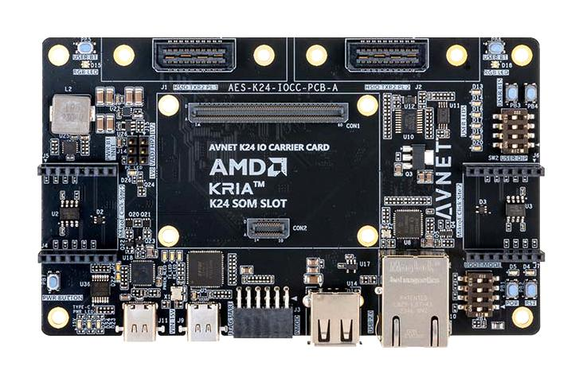
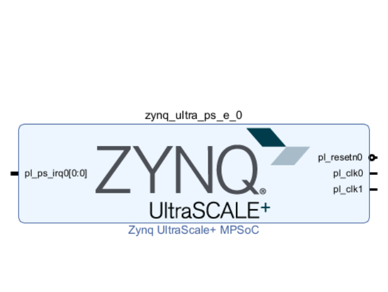
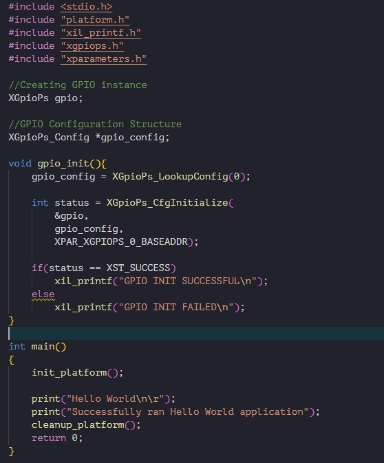

# Avnet K24 – PS MIO LED Blink

A step-by-step implementation of onboard LED control on the Avnet K24 Development Kit using Processing System (PS) MIO GPIO. This project demonstrates hardware configuration in Vivado, software platform development in Vitis, and bare-metal C programming on the AMD Zynq UltraScale+ MPSoC.

---

## 1. Project Overview

This project demonstrates how to configure and control an onboard LED directly from the Processing System (PS) of the Avnet K24 Development Kit.

The target LED is **D13**, connected to **MIO27**. Using the PS GPIO peripheral, the ARM Cortex-A53 processor configures MIO27 as an output and controls the LED through a bare-metal C application.

Unlike implementations that use Programmable Logic (PL), this approach uses the PS MIO interface. Therefore, no custom RTL, AXI GPIO IP, or PL pin constraints are required.

The project is organized into three implementation stages:

1. **Vivado Hardware Configuration:** Configure the Zynq UltraScale+ MPSoC and enable the required MIO GPIO bank.
2. **Vitis Software Platform:** Import the exported hardware design and create a standalone software platform.
3. **Bare-Metal GPIO Programming:** Use the Xilinx `XGpioPs` driver to configure MIO27 and control the onboard LED.

## 2. Hardware and Software Requirements

### Hardware

- Avnet K24 Development Kit (Kria K24 SOM and carrier card)
- USB cable for board programming and UART communication
- Host computer

### Software

- AMD Vivado 2023.2 or newer
- AMD Vitis 2023.2 or newer
- USB-to-UART/JTAG drivers
- CoolTerm or another serial terminal application

## 3. Hardware Platform

The Avnet K24 Development Kit is based on the AMD Zynq UltraScale+ MPSoC architecture, which combines a Processing System (PS) and Programmable Logic (PL).

### Processing System (PS)

The PS contains the ARM processing cores and integrated peripherals such as GPIO, UART, Ethernet, and USB. It handles software execution and provides interfaces to external peripherals.

### Programmable Logic (PL)

The PL consists of FPGA fabric that can be configured to implement custom digital hardware, accelerators, and peripheral interfaces.

### Multiplexed Input/Output (MIO)

MIO provides direct connections between PS peripherals and physical device pins. It allows the processor to access supported external signals without routing them through the PL.

For this project, the PS GPIO controller uses MIO27 to control the onboard D13 LED.

### Onboard LED Mapping

| Board LED | MIO Pin | Function |
|---|---:|---|
| D13 | MIO27 | Target LED |
| D14 | MIO28 | Onboard LED |
| D16 | MIO29 | Onboard LED |
| D17 | MIO30 | Onboard LED |

**Target configuration: D13 → MIO27 → PS GPIO**

### Avnet K24 Development Board



*Figure 1: Avnet K24 Development Kit used for this project.*

## 4. Project Implementation

### Part 1 – Vivado Hardware Configuration

The first stage involves creating a Vivado project and configuring the Zynq UltraScale+ MPSoC.

#### Implementation Steps

1. Create a new Vivado RTL project for the Avnet K24 Development Kit.
2. Create a block design.
3. Add the Zynq UltraScale+ MPSoC IP.
4. Run Block Automation using the board configuration.
5. Open the processing system configuration.
6. Navigate to **I/O Configuration → Low Speed → GPIO MIO Banks**.
7. Enable the GPIO1 MIO bank, which contains MIO27.
8. Validate the block design.
9. Create the HDL wrapper.
10. Run synthesis and implementation.
11. Generate the bitstream.
12. Export the hardware design as an XSA file, including the bitstream.

#### Vivado Block Design



*Figure 2: Zynq UltraScale+ MPSoC block design in Vivado.*

#### GPIO MIO Configuration


*Figure 3: GPIO MIO configuration in the Zynq UltraScale+ MPSoC settings.*

**Important:** MIO27 belongs to the GPIO1 MIO bank. Enabling the appropriate GPIO MIO bank is necessary for the PS GPIO peripheral to control the target pin.

For this implementation, no additional PL logic or external PL pin constraints are required.

### Part 2 – Vitis Software Platform

After completing the hardware design in Vivado, export the XSA file and import it into Vitis to create the software platform.

#### Implementation Steps

1. Launch Vitis.
2. Create a new platform component.
3. Import the XSA file exported from Vivado.
4. Select the `psu_cortexa53_0` processor.
5. Select the Standalone operating system for bare-metal development.
6. Build the platform to generate the Board Support Package (BSP).
7. Create a new application component.
8. Select the generated platform and Cortex-A53 standalone domain.
9. Use the Hello World application template to verify the software environment.
10. Build and run the application.

The generated BSP provides access to the PS GPIO driver through the `XGpioPs` API.

#### Vitis Workspace



*Figure 4: Vitis workspace containing the software platform and application.*

#### UART Verification

Before implementing GPIO control, verify that the application can communicate with the host computer through the board's UART interface.

Configure the serial terminal with:

| Parameter | Value |
|---|---|
| Baud rate | 115200 |
| Data bits | 8 |
| Parity | None |
| Stop bits | 1 |

The Hello World application can be used to verify UART communication and basic software execution.

### Part 3 – Bare-Metal MIO GPIO Programming

The final stage involves writing a bare-metal C application to control the onboard LED through MIO27.

The implementation uses the Xilinx PS GPIO driver, `XGpioPs`.

#### Required Header Files

The application uses the following headers:

```c
#include "xgpiops.h"
#include "xparameters.h"
#include "xil_printf.h"
#include "sleep.h"
#include "xstatus.h"
```

#### GPIO Initialization

The GPIO driver instance is declared using:

```c
XGpioPs gpio;
```

The GPIO configuration is retrieved using:

```c
XGpioPs_Config *gpio_config;

gpio_config = XGpioPs_LookupConfig(0);
```

For the generated BSP used in this project, `0` is used to retrieve the single GPIO controller configuration.

The driver is then initialized:

```c
int status;

status = XGpioPs_CfgInitialize(
    &gpio,
    gpio_config,
    XPAR_XGPIOPS_0_BASEADDR
);
```

The return status should be checked to confirm successful initialization.

#### Configure MIO27 as an Output

The direction of the GPIO pin is configured using:

```c
XGpioPs_SetDirectionPin(&gpio, 27, 1);
```

The second argument specifies the MIO pin number, while `1` configures the pin as an output.

The output driver is enabled using:

```c
XGpioPs_SetOutputEnablePin(&gpio, 27, 1);
```

#### Control the LED

The GPIO output can be controlled using:

```c
XGpioPs_WritePin(&gpio, 27, 1);
```

To change the output state:

```c
XGpioPs_WritePin(&gpio, 27, 0);
```

A delay can be introduced between output transitions using `sleep()` or `usleep()` from the appropriate sleep header.

The application continuously alternates the GPIO output state to produce the blinking effect.

**Note:** The relationship between the GPIO logic level and the LED's illuminated state depends on the board's LED electrical polarity. Verify the actual behavior on the hardware.

## 5. GPIO Driver Function Reference

| Function | Description |
|---|---|
| `XGpioPs_LookupConfig()` | Retrieves the GPIO peripheral configuration. |
| `XGpioPs_CfgInitialize()` | Initializes the GPIO driver instance. |
| `XGpioPs_SetDirectionPin()` | Configures a GPIO pin as an input or output. |
| `XGpioPs_SetOutputEnablePin()` | Enables or disables the GPIO output driver. |
| `XGpioPs_WritePin()` | Writes a logic level to a GPIO pin. |

## 6. Repository Structure

```text
k24-ps-mio-led-blink/
│
├── README.md
│
├── docs/
│   ├── part1-vivado-setup.md
│   ├── part2-vitis-setup.md
│   └── part3-mio-gpio-programming.md
│
├── src/
│   └── main.c
│
├── images/
│   ├── GPIO MIO Configuration.png
│   ├── k24_development_board.jpg
│   ├── vitis_workspace.png
│   └── vivado_block_design.png
│
├── .gitignore
└── LICENSE
```

## 7. Expected Result

After successfully building and running the bare-metal application, the onboard D13 LED should blink continuously.

The application executes on the ARM Cortex-A53 processor and controls the LED directly through the PS GPIO peripheral using MIO27.

## 8. Key Learning Outcomes

This project provides practical experience with:

- Zynq UltraScale+ MPSoC architecture.
- Processing System configuration in Vivado.
- MIO GPIO configuration and pin mapping.
- Hardware platform generation and XSA export.
- Vitis software platform development.
- Bare-metal C programming on the ARM Cortex-A53.
- Xilinx PS GPIO driver integration.
- Direct control of physical board peripherals.

## 9. Possible Extensions

The implementation can be extended to explore additional PS GPIO functionality:

- Control multiple onboard LEDs using MIO.
- Implement LED patterns and timing sequences.
- Read physical button inputs through PS GPIO.
- Compare MIO-based GPIO with EMIO-based GPIO.
- Develop interrupt-driven GPIO applications.

## 10. References

- [AMD Vivado Design Suite Documentation](https://docs.amd.com/)
- [AMD Vitis Unified Software Platform Documentation](https://docs.amd.com/r/en-US/ug1400-vitis-embedded)
- [Zynq UltraScale+ MPSoC Technical Reference Manual (UG1085)](https://docs.amd.com/v/u/en-US/ug1085-zynq-ultrascale-trm)
- [Avnet](https://www.avnet.com/)

---

## Project Information

| Parameter | Description |
|---|---|
| Development Board | Avnet K24 Development Kit |
| SoC Architecture | AMD Zynq UltraScale+ MPSoC |
| Processor | ARM Cortex-A53 |
| Interface | PS MIO GPIO |
| Target GPIO | MIO27 |
| Target LED | D13 |
| Programming Language | C |
| Development Tools | Vivado and Vitis |
| Application Type | Bare-metal |

**Project Focus:** Direct control of onboard hardware peripherals using the Processing System MIO interface.
