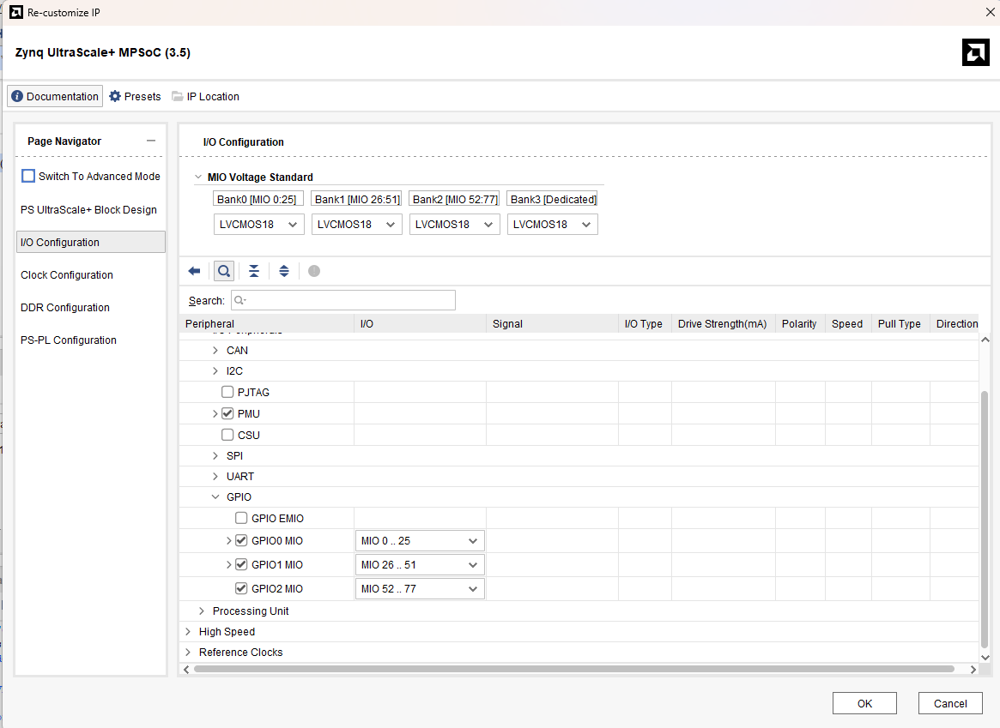
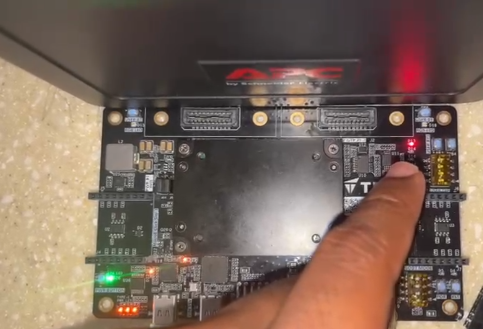

# Avnet K24 – PS MIO LED Blink

A step-by-step implementation of onboard LED control on the Avnet K24 Development Kit using Processing System (PS) MIO GPIO. This project demonstrates hardware configuration in Vivado, software platform development in Vitis, and bare-metal C programming on the AMD Zynq UltraScale+ MPSoC.


## 1. Project Overview

This project demonstrates how to control the onboard D13 LED of the Avnet K24 Development Kit directly through the Processing System GPIO peripheral.

The LED is connected to **MIO27**. A bare-metal C application running on the ARM Cortex-A53 processor configures MIO27 as an output and periodically toggles its logic state to produce a blinking effect.

The implementation uses the integrated PS GPIO controller through the Xilinx `XGpioPs` driver.

Unlike implementations that use Programmable Logic (PL), this approach does not require custom RTL, AXI GPIO IP, or PL pin constraints.

### Project Objectives

- Configure the Zynq UltraScale+ MPSoC Processing System in Vivado.
- Enable the GPIO1 MIO bank.
- Export the hardware platform as an XSA file.
- Create a standalone software platform in Vitis.
- Develop a bare-metal C application using the Xilinx PS GPIO driver.
- Control the onboard D13 LED through MIO27.

## 2. Hardware and Software Requirements

### Hardware

- Avnet K24 Development Kit (Kria K24 SOM and carrier card).
- USB cable for board programming and UART communication.
- Host computer.

### Software

- AMD Vivado 2023.2 or newer.
- AMD Vitis 2023.2 or newer.
- USB-to-UART/JTAG drivers.
- CoolTerm or another serial terminal application.

## 3. Hardware Configuration

The target LED for this implementation is D13, connected to MIO27.

### Onboard LED Mapping

| Board LED | MIO Pin | Function |
|---|---:|---|
| D13 | MIO27 | Target LED |
| D14 | MIO28 | Onboard LED |
| D16 | MIO29 | Onboard LED |
| D17 | MIO30 | Onboard LED |

**Target configuration: D13 → MIO27 → PS GPIO**

### Vivado GPIO Configuration

The GPIO1 MIO bank is enabled in the Zynq UltraScale+ MPSoC configuration to make MIO27 available to the PS GPIO controller.



*GPIO MIO configuration in Vivado.*

## 4. Project Demonstration

The bare-metal application continuously toggles MIO27, producing a blinking effect on the onboard D13 LED.



*Onboard D13 LED controlled through PS MIO27.*

## 5. Implementation Workflow

The project is divided into three stages. Each stage has a dedicated tutorial with detailed instructions and screenshots.

### Part 1 – Vivado Hardware Configuration

Configure the Zynq UltraScale+ MPSoC in Vivado and enable the GPIO1 MIO bank.

The hardware design is validated, the bitstream is generated, and the hardware platform is exported as an XSA file.

**Topics covered:**
- Vivado project creation.
- Avnet K24 board selection.
- Zynq UltraScale+ MPSoC block design.
- GPIO1 MIO configuration.
- Design validation.
- HDL wrapper generation.
- Bitstream generation.
- Hardware export.

[Read Part 1: Vivado Hardware Configuration](docs/part1-vivado-setup.md)

### Part 2 – Vitis Software Platform Setup

Import the XSA hardware specification into Vitis and create a standalone software platform targeting the ARM Cortex-A53 processor.

A Hello World application is used to verify application execution and UART communication before implementing GPIO control.

**Topics covered:**
- Vitis workspace creation.
- XSA hardware import.
- Platform component creation.
- Cortex-A53 processor selection.
- Standalone operating system configuration.
- BSP and driver generation.
- Hello World application.
- CoolTerm UART configuration.
- Application debugging and execution.

[Read Part 2: Vitis Software Platform Setup](docs/part2-vitis-setup.md)

### Part 3 – Bare-Metal MIO GPIO Programming

Develop a bare-metal C application to initialize and control the PS GPIO peripheral using the Xilinx `XGpioPs` driver.

MIO27 is configured as an output, its output driver is enabled, and the application continuously toggles the pin to control the D13 LED.

**Topics covered:**
- Xilinx PS GPIO driver.
- BSP driver integration.
- `XGpioPs` configuration structure.
- GPIO configuration lookup.
- GPIO driver initialization.
- MIO27 direction configuration.
- GPIO output enable.
- GPIO output control.
- Application build and execution.

[Read Part 3: Bare-Metal MIO GPIO Programming](docs/part3-mio-gpio-programming.md)

## 6. Source Code

The main application is located in:

`src/main.c`

The application uses the following Xilinx driver functions:

| Function | Description |
|---|---|
| `XGpioPs_LookupConfig()` | Retrieves the GPIO configuration. |
| `XGpioPs_CfgInitialize()` | Initializes the GPIO driver. |
| `XGpioPs_SetDirectionPin()` | Configures MIO27 as an output. |
| `XGpioPs_SetOutputEnablePin()` | Enables the GPIO output driver. |
| `XGpioPs_WritePin()` | Writes logic HIGH or LOW to MIO27. |

The GPIO output is toggled with a one-second delay between transitions.

## 7. Repository Structure

```text
k24-ps-mio-led-blink/
│
├── README.md
│
├── src/
│   └── main.c
│
├── docs/
│   ├── part1-vivado-setup.md
│   ├── part2-vitis-setup.md
│   └── part3-mio-gpio-programming.md
│
├── images/
│   ├── k24_development_board.jpg
│   ├── gpio_mio_configuration.png
│   ├── led_blinking.png
│   ├── vivado_block_design.png
│   ├── vitis_workspace.png
│   └── ...
│
├── .gitignore
└── LICENSE
```

## 8. Expected Result

After successfully building and running the application:

- The PS GPIO controller initializes successfully.
- MIO27 is configured as an output.
- The output driver is enabled.
- The application continuously toggles the GPIO output.
- The onboard D13 LED blinks.

## 9. Key Learning Outcomes

This project provides practical experience with:

- Zynq UltraScale+ MPSoC development.
- Processing System configuration in Vivado.
- MIO GPIO configuration and pin mapping.
- Hardware platform generation and XSA export.
- Vitis software platform development.
- Bare-metal C programming on the ARM Cortex-A53.
- Xilinx PS GPIO driver integration.
- Direct control of physical board peripherals.

## 10. Possible Extensions

The implementation can be extended to explore additional PS GPIO functionality:

- Control multiple onboard LEDs using MIO.
- Implement LED patterns and timing sequences.
- Read physical button inputs through PS GPIO.
- Compare MIO-based GPIO with EMIO-based GPIO.
- Develop interrupt-driven GPIO applications.

## 11. References

- [AMD Vivado Design Suite Documentation](https://docs.amd.com/)
- [AMD Vitis Unified Software Platform Documentation](https://docs.amd.com/r/en-US/ug1400-vitis-embedded)
- [Zynq UltraScale+ MPSoC Technical Reference Manual (UG1085)](https://docs.amd.com/v/u/en-US/ug1085-zynq-ultrascale-trm)
- [Avnet](https://www.avnet.com/)

---

## Project Information

| Parameter | Description |
|---|---|
| Development Board | Avnet K24 Development Kit |
| SoC | AMD Zynq UltraScale+ MPSoC |
| Processor | ARM Cortex-A53 |
| GPIO Interface | PS MIO |
| Target GPIO | MIO27 |
| Target LED | D13 |
| Programming Language | C |
| Development Tools | Vivado and Vitis |
| Application Type | Bare-metal |

**Project Focus:** Direct control of onboard hardware peripherals using the Processing System MIO interface.
