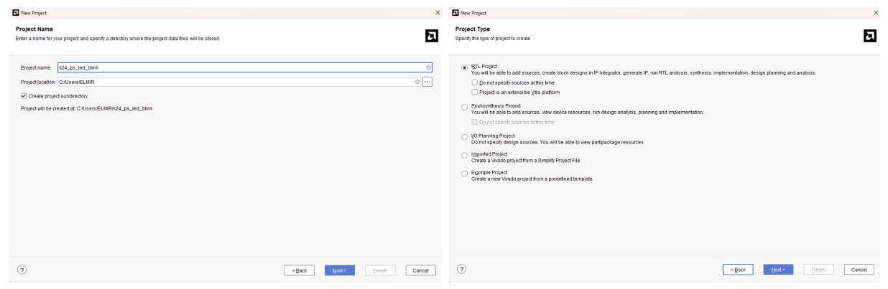
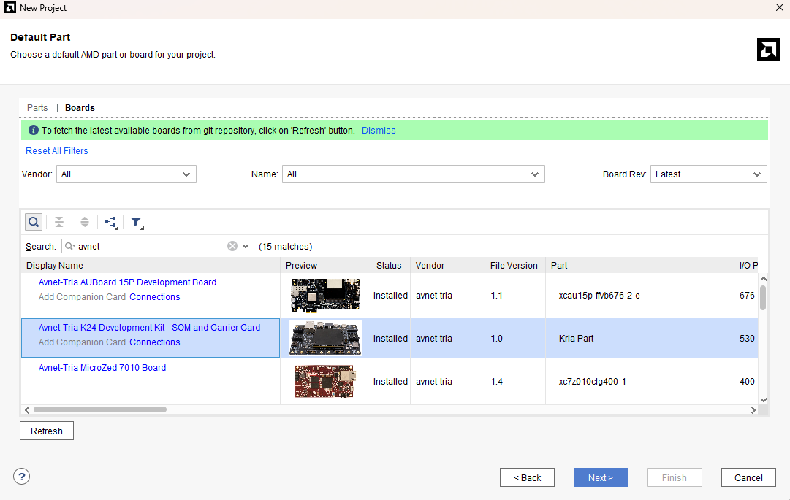
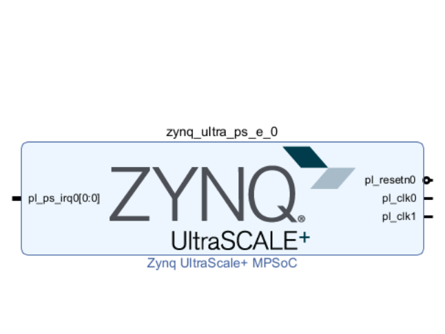
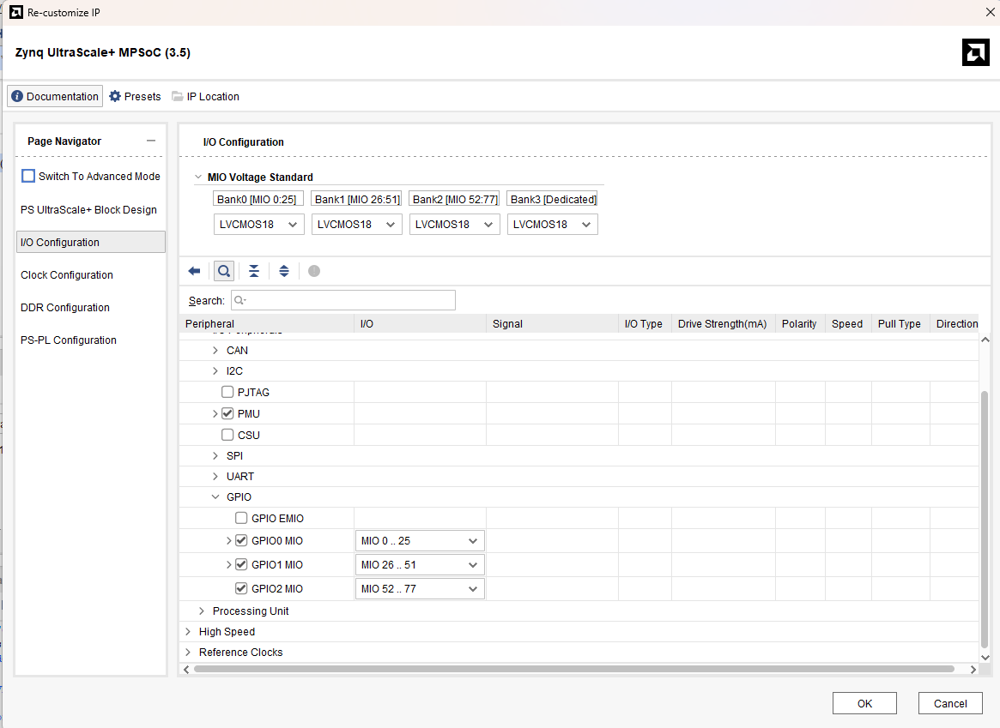
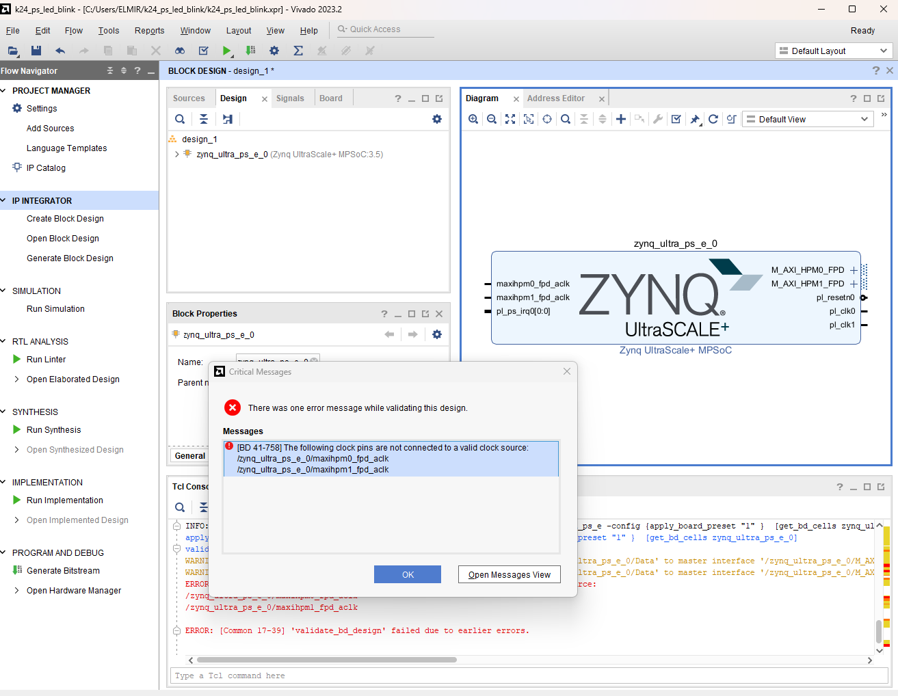
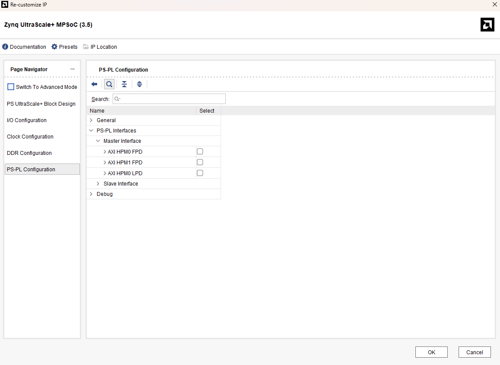
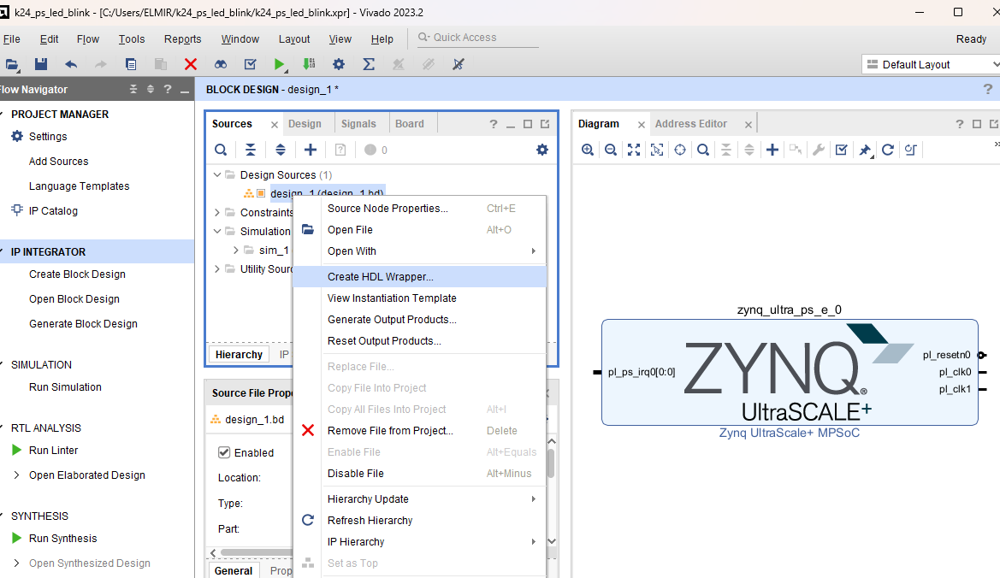
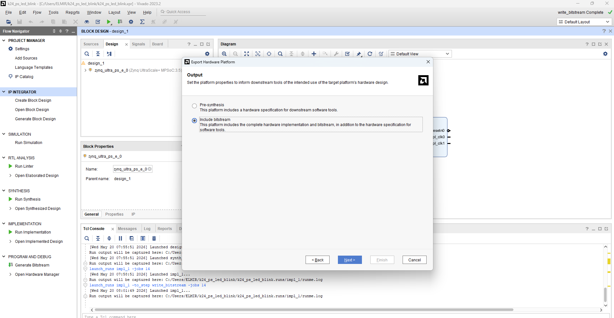

# Part 1: Vivado Hardware Configuration – Avnet K24 PS MIO LED Blink

## 1. Introduction

This section covers the hardware configuration required to control the onboard D13 LED of the Avnet K24 Development Kit through the Processing System (PS) GPIO peripheral.

The target LED is connected to MIO27. The objective is to configure the Zynq UltraScale+ MPSoC Processing System to make the appropriate GPIO functionality available through the MIO interface.

The hardware design is implemented entirely within the Processing System. No custom RTL modules, AXI GPIO IP, or additional Programmable Logic (PL) functionality are required.

### Objectives

By the end of this section, you should be able to:

- Create a Vivado project for the Avnet K24 Development Kit.
- Add and configure the Zynq UltraScale+ MPSoC IP.
- Enable the GPIO1 MIO bank.
- Validate the hardware design.
- Generate the hardware bitstream.
- Export the hardware specification as an XSA file for Vitis.

## 2. Create a Vivado Project

Launch AMD Vivado and create a new project.

1. Select **File → Project → New**.
2. Enter the project name:

   `k24_ps_led_blink`

3. Select a suitable project directory.
4. Choose **RTL Project**.
5. Select the option to proceed without adding sources.
6. Continue to the Default Part or Boards selection window.

### 2.1 Project Name

Use the following project name:

`k24_ps_led_blink`

*Figure 1: Specifying the Vivado project name.*

### 2.2 Select the Development Board

In the board selection window, select:

`Avnet-Tria K24 Development Kit - SOM and Carrier Card`

Ensure that the correct board is selected before completing the project creation wizard.

*Figure 2: Selecting the Avnet K24 Development Kit board.*

Complete the wizard to create the project.

## 3. Create the Block Design

The next step is to create a block design containing the Zynq UltraScale+ MPSoC Processing System.

1. Open the **IP Integrator** section in the Flow Navigator.
2. Select **Create Block Design**.
3. Enter the block design name:

   `design_1`

4. Click **OK**.
5. In the Diagram window, click **Add IP**.
6. Search for:

   `Zynq UltraScale+ MPSoC`

7. Add the IP to the block design.

The Zynq UltraScale+ MPSoC IP provides access to the ARM processing system and its integrated peripherals, including the PS GPIO controller.

### 3.1 Configure the Processing System

After adding the Zynq UltraScale+ MPSoC IP, run Block Automation to apply the board-specific processing system configuration.

1. Click **Run Block Automation**.
2. Review the available configuration options.
3. Retain the default board configuration.
4. Click **OK**.

Vivado applies the board configuration and prepares the Processing System.

The resulting block design contains the Zynq UltraScale+ MPSoC IP configured for the K24 development platform.

*Figure 3: Zynq UltraScale+ MPSoC block design in Vivado.*

## 4. Configure the GPIO MIO Bank

This is the most important configuration step in the project.

The onboard D13 LED is connected to MIO27. For the processor to control this pin through the PS GPIO peripheral, the appropriate GPIO MIO bank must be enabled.

### 4.1 Open the Processing System Configuration

1. Double-click the Zynq UltraScale+ MPSoC block.
2. Navigate to **I/O Configuration**.
3. Expand **Low Speed**.
4. Locate **GPIO MIO Banks**.

### 4.2 Enable GPIO1 MIO

Enable the GPIO1 MIO bank, which includes MIO pins 26 through 51.

MIO27 belongs to this bank, so enabling it makes the required GPIO pin available to the Processing System.

*Figure 4: Enabling the GPIO MIO bank in the Processing System configuration.*

The GPIO MIO configuration should include the following:

| Parameter | Configuration |
|---|---|
| Peripheral | PS GPIO |
| GPIO Bank | GPIO1 MIO |
| MIO Pin | MIO27 |
| Board LED | D13 |
| Direction | Output (configured later in software) |

*Figure 5: GPIO MIO configuration in the Zynq UltraScale+ MPSoC settings.*

After enabling the appropriate bank, apply the configuration and close the Processing System settings.

**Important:** MIO27 belongs to the GPIO1 MIO bank. Enabling the appropriate GPIO MIO functionality in Vivado makes the pin available to the PS GPIO controller. The pin direction and output enable are configured later in the bare-metal application.

## 5. Validate the Block Design

After configuring the Processing System, validate the block design.

1. Return to the block design diagram.
2. Click **Validate Design**.
3. Review any reported errors or warnings.

*Figure 6: Running design validation in Vivado.*

### 5.1 Troubleshooting Validation Errors

If Vivado reports validation errors associated with unused PS-PL AXI master interfaces that do not have clocks connected, review the PS-PL interface configuration.

For this project, unused interfaces such as:

- AXI HPM0 FPD
- AXI HPM1 FPD

can be disabled under:

**PS-PL Configuration → PS-PL Interfaces → Master Interface**

provided they are not required by the design.

*Figure 7: Example of the validation issue and its configuration adjustment.*

After making the necessary changes, run **Validate Design** again.

The design should pass validation before proceeding to HDL wrapper generation.

## 6. Create the HDL Wrapper

Once the block design passes validation, generate the HDL wrapper.

1. Navigate to the Sources window.
2. Expand **Design Sources**.
3. Right-click `design_1.bd`.
4. Select **Create HDL Wrapper**.
5. Choose **Let Vivado manage wrapper and auto-update**.
6. Click **OK**.

*Figure 8: Creating the HDL wrapper for the block design.*

Vivado generates the top-level HDL wrapper for the block design.

No additional RTL modules are required for this implementation because the project uses the integrated PS GPIO controller.

## 7. Generate the Bitstream

The next step is to generate the hardware bitstream.

From the Flow Navigator:

1. Click **Run Synthesis**.
2. Wait for synthesis to complete.
3. Click **Run Implementation**.
4. Allow implementation to complete.
5. Click **Generate Bitstream**.

The generated bitstream represents the configured Programmable Logic design.

Although this project does not implement custom PL logic, the hardware export can include the bitstream generated by Vivado.

## 8. Export the Hardware Design

After successfully generating the bitstream, export the hardware design for use in Vitis.

1. Navigate to **File → Export → Export Hardware**.
2. Select the option to include the bitstream.
3. Continue through the export wizard.
4. Specify the output location.
5. Complete the export.

*Figure 9: Exporting the Vivado hardware design.*

Vivado generates an XSA file containing the hardware platform information and, when selected, the bitstream.

The XSA file will be imported into Vitis in Part 2.

## 9. Expected Outcome

At the end of this stage, you should have:

- A Vivado project configured for the Avnet K24 Development Kit.
- A Zynq UltraScale+ MPSoC block design.
- The GPIO1 MIO bank enabled.
- A validated hardware design.
- A generated bitstream.
- An exported XSA file.

The exported XSA file is the main deliverable from this stage and will serve as the hardware specification for the Vitis software platform.

## 10. Summary

In this stage, the Zynq UltraScale+ MPSoC was configured to make MIO27 available through the PS GPIO peripheral.

The design uses the integrated Processing System GPIO functionality rather than implementing a separate GPIO controller in the Programmable Logic.

The resulting XSA file provides the hardware platform required to develop the bare-metal GPIO application in Vitis.

**Next:** [Part 2 – Vitis Software Platform Setup](part2-vitis-setup.md)
