# Part 2: Vitis Software Platform Setup – Avnet K24 PS MIO LED Blink

## 1. Introduction

After completing the hardware configuration in Vivado, the next step is to develop the software platform required to communicate with and control the Processing System (PS) peripherals.

In this stage, the exported XSA hardware specification is imported into AMD Vitis to create a software platform for the Zynq UltraScale+ MPSoC.

The platform is configured to use the ARM Cortex-A53 processor running the Standalone operating system. This enables bare-metal C application development without requiring an embedded Linux environment.

Before implementing the GPIO functionality, a Hello World application is created and executed to verify the software environment and UART communication.

### Objectives

By the end of this section, you should be able to:

- Launch Vitis from Vivado.
- Create a Vitis workspace.
- Import a Vivado-generated XSA file.
- Create and configure a software platform.
- Select the ARM Cortex-A53 processor.
- Configure the Standalone operating system.
- Select the required software drivers.
- Generate the Board Support Package (BSP).
- Create and build a bare-metal application.
- Configure UART communication using CoolTerm.
- Debug and execute an application on the K24 development board.

## 2. Launch AMD Vitis

After exporting the hardware design from Vivado, launch AMD Vitis.

Vitis can be launched directly from Vivado using:

**Tools → Launch Vitis IDE**

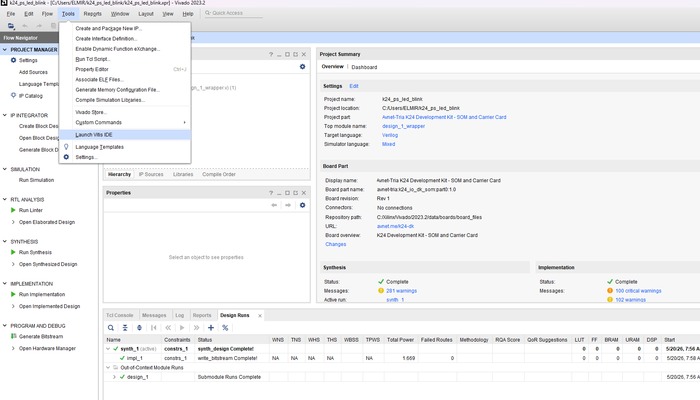

*Figure 1: Launching Vitis from the Vivado development environment.*

Alternatively, Vitis can be opened directly from the operating system.

## 3. Create a Vitis Workspace

When Vitis starts, it prompts you to select a workspace directory.

The workspace stores the software platform, application components, build configurations, and generated project files.

For this project, use:

`k24_blink_workspace`

Choose a suitable directory and open the workspace.

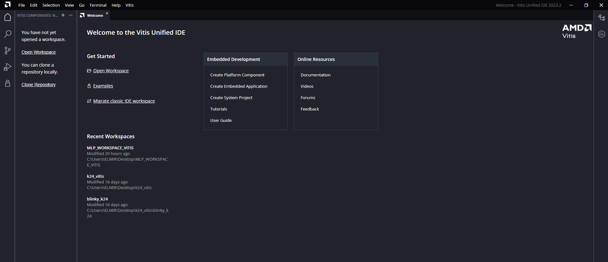

*Figure 2: Selecting and opening the Vitis workspace.*

The workspace is now ready for platform and application development.

## 4. Create a Vitis Platform Component

The first task is to create a software platform using the XSA file exported from Vivado.

Navigate to:

**File → New Component → Platform**

### 4.1 Specify the Platform Name

Enter the platform component name:

`k24_platform`

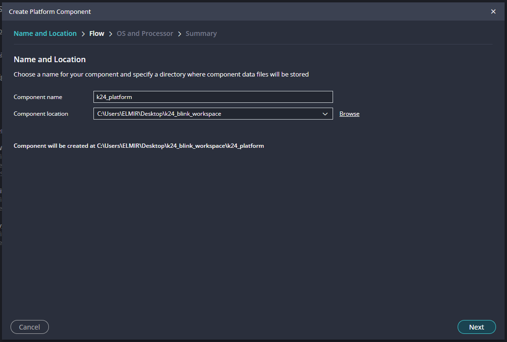

*Figure 3: Specifying the Vitis platform component name.*

### 4.2 Create the Platform Component

Proceed through the platform creation wizard.

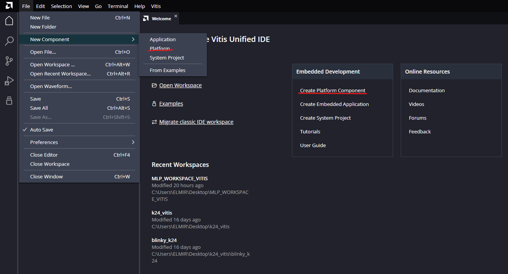

*Figure 4: Creating a new Vitis platform component.*

The platform component provides the connection between the exported hardware specification and the software applications that will execute on the processor.

## 5. Import the Hardware Design

The next step is to import the XSA file generated during Part 1.

Select the option to use an existing hardware specification and browse to the exported XSA file.

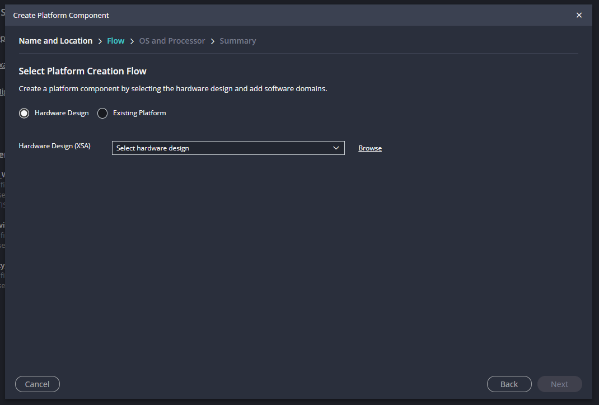

*Figure 5: Importing the Vivado hardware specification into Vitis.*

If you need to locate the exported hardware file, navigate to the directory where Vivado saved the XSA.

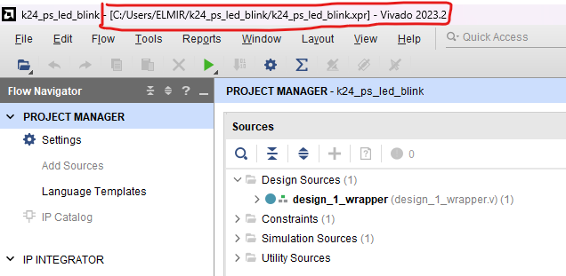

*Figure 6: Locating the exported XSA file.*

Select the appropriate XSA file and continue.

The XSA contains the hardware platform information required by Vitis to configure the software platform.

## 6. Configure the Software Platform

After importing the hardware specification, configure the processor, operating system, and drivers.

### 6.1 Select the Processor

The K24 platform uses the Zynq UltraScale+ MPSoC Processing System.

For this project, select:

`psu_cortexa53_0`

This corresponds to an ARM Cortex-A53 application processing core.

### 6.2 Select the Operating System

Choose:

`Standalone`

The Standalone operating system provides a bare-metal software environment. Applications execute directly on the processor without requiring an operating system such as Linux.

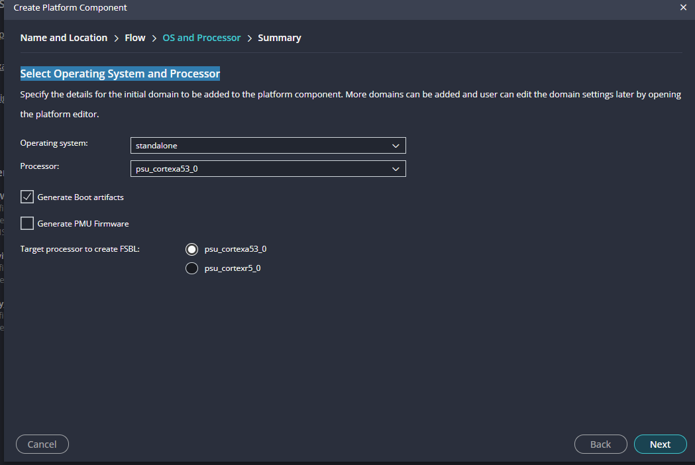

*Figure 7: Selecting the Standalone operating system.*

### 6.3 Select the Platform

Choose the generated platform configuration for the application domain.

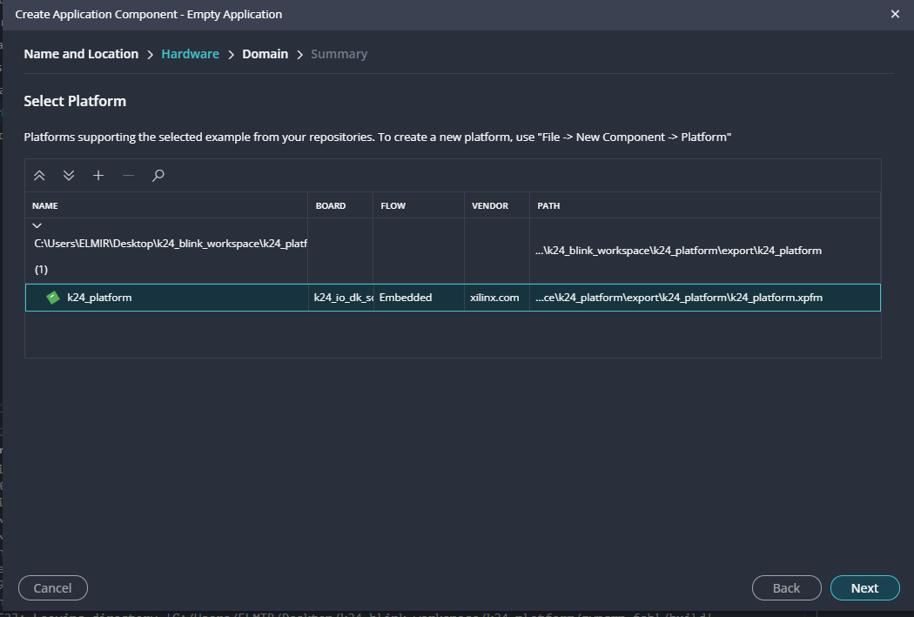

*Figure 8: Selecting the software platform.*

### 6.4 Select Software Drivers

Vitis uses the hardware specification to determine which peripheral drivers are available.

Select the appropriate drivers for the platform.

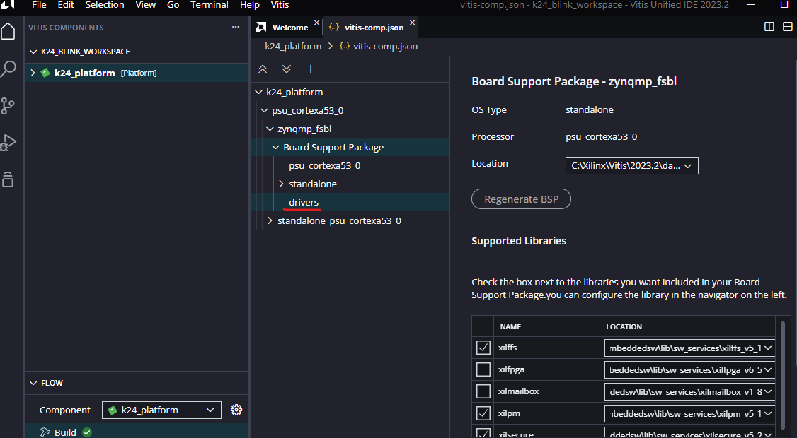

*Figure 9: Selecting software drivers for the platform.*

The important driver for this project is the PS GPIO driver, which provides the `XGpioPs` API.

The primary header file is:

```c
#include "xgpiops.h"
```

The generated BSP also provides hardware configuration definitions through:

```c
#include "xparameters.h"
```

For this implementation, the GPIO controller base address is accessed using:

```c
XPAR_XGPIOPS_0_BASEADDR
```

### 6.5 Review Platform Configuration

After configuring the processor, operating system, and drivers, review the platform settings.

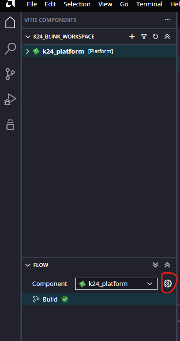

*Figure 10: Reviewing the platform configuration.*

Complete the wizard to generate the platform component.

## 7. Build the Software Platform

Once the platform has been configured, build the component.

During platform generation, Vitis creates the Board Support Package (BSP) and prepares the software environment for the selected processor.

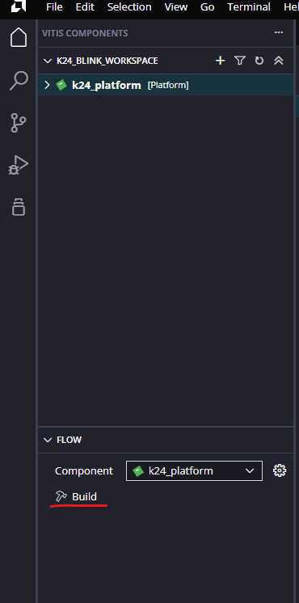

*Figure 11: Building the Vitis software platform.*

The BSP provides the software drivers and hardware abstraction needed to access peripherals defined in the hardware platform.

For this project, the important driver is the PS GPIO driver.

The generated BSP provides functions for:

- Initializing the GPIO controller.
- Configuring GPIO pin direction.
- Enabling GPIO output drivers.
- Writing output values.
- Reading GPIO input values.

After a successful build, the software platform is ready for application development.

## 8. Create a Bare-Metal Application

Once the platform has been successfully generated, create an application component.

Navigate to:

**File → New Component → Application**

### 8.1 Specify the Application Name

Enter:

`k24_led_blink_app`

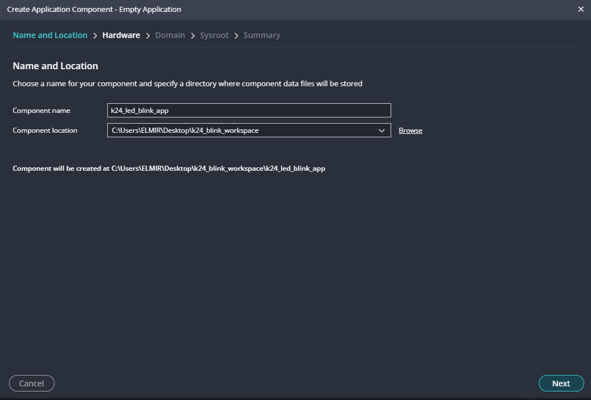

*Figure 12: Specifying the application component name.*

### 8.2 Create the Application Project

Select the generated platform:

`k24_platform`

Choose the Cortex-A53 standalone domain and proceed with application creation.

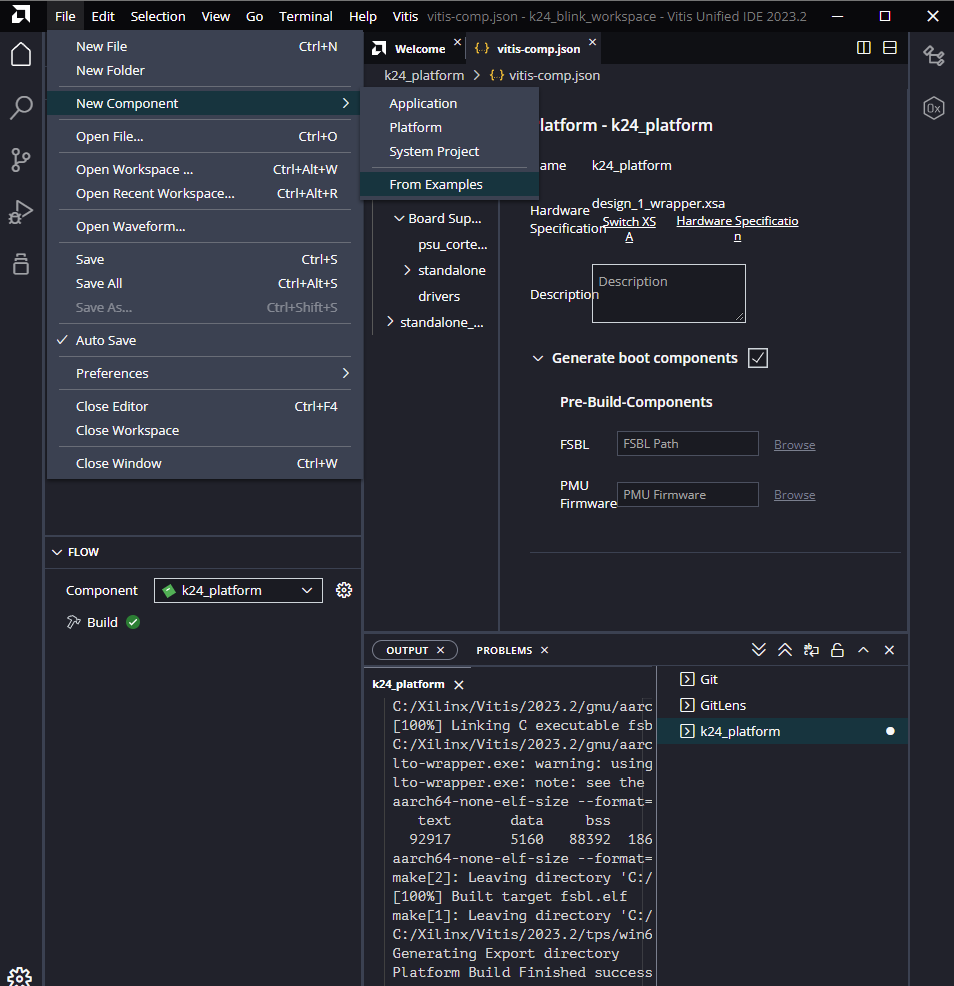

*Figure 13: Creating the bare-metal application project.*

### 8.3 Select the Hello World Template

For the initial software verification, select the Hello World application template.

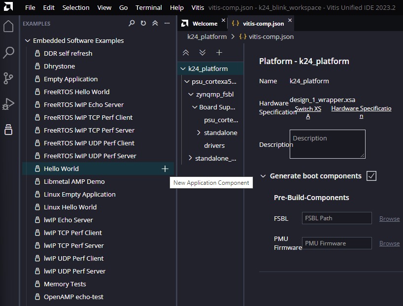

*Figure 14: Selecting the Hello World application template.*

The template generates a basic C application that can be used to verify the software environment.

### 8.4 Review the Application

After creating the application, inspect the generated project and its source files.

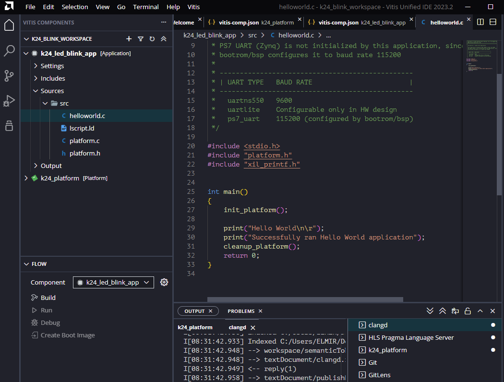

*Figure 15: Hello World application loaded in Vitis.*

## 9. Build the Application

After creating the application, build it to ensure that the source code compiles successfully.

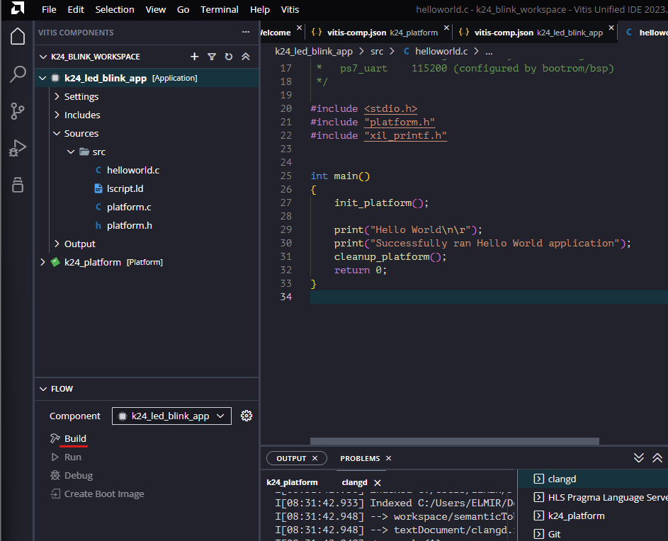

*Figure 16: Building the Hello World application.*

A successful build confirms that the application can be compiled against the generated software platform and BSP.

## 10. Configure UART Communication

Before implementing GPIO control, verify that the application can communicate with the host computer through the board's UART interface.

UART verification confirms that the application can execute and transmit debugging messages to a serial terminal.

### 10.1 Connect to the Board

Connect the K24 development board to the host computer using the appropriate USB connection.

Ensure that the required USB-to-UART drivers are installed and that the board's serial interface is detected.

### 10.2 Open CoolTerm

Launch CoolTerm and open its serial port configuration.


*Figure 17: Accessing the serial terminal configuration.*

### 10.3 Configure the Serial Port

Select the COM port corresponding to the board's UART interface.

Configure the serial connection as follows:

| Parameter | Value |
|---|---|
| Port | Detected K24 UART COM port |
| Baud Rate | 115200 |
| Data Bits | 8 |
| Parity | None |
| Stop Bits | 1 |
| Flow Control | None |

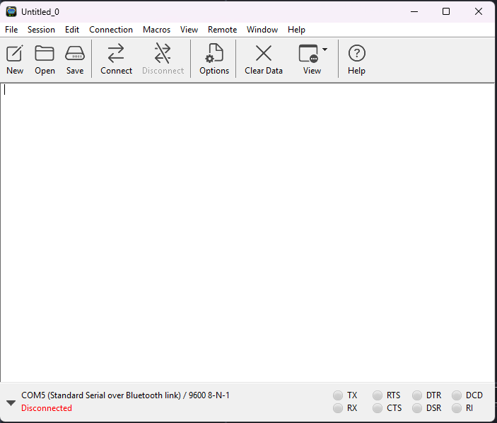

*Figure 18: Configuring the CoolTerm serial connection.*

The serial terminal must use the same communication parameters as the application.

### 10.4 Configure the Serial Data Format

Ensure that the terminal uses 8 data bits, no parity, and one stop bit.

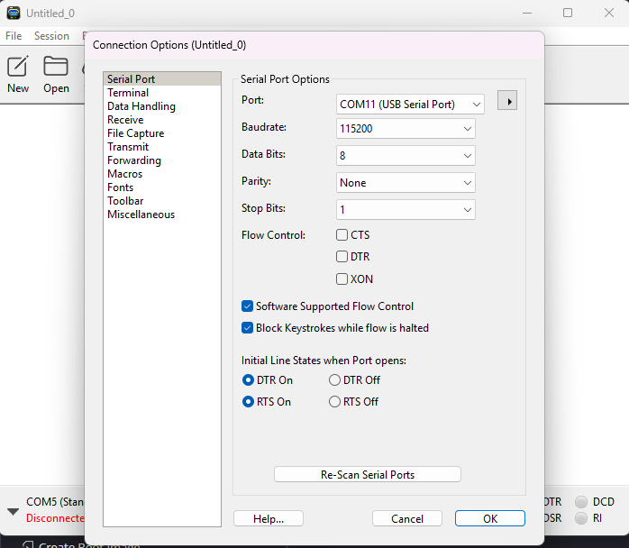

*Figure 19: Configuring UART communication using 8-N-1 format.*

### 10.5 Connect to the Serial Port

Select the detected COM port and establish the serial connection.

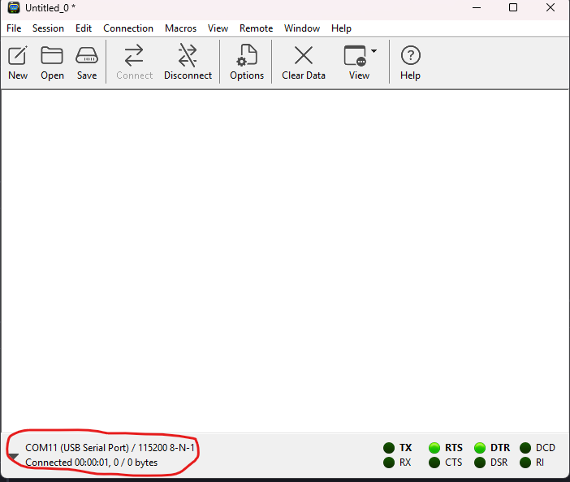

*Figure 20: Establishing the UART connection using CoolTerm.*

## 11. Debug and Run the Application

After building the Hello World application and configuring the serial terminal, execute the application on the target board.

### 11.1 Start the Debug Session

Launch the Vitis debugging session.

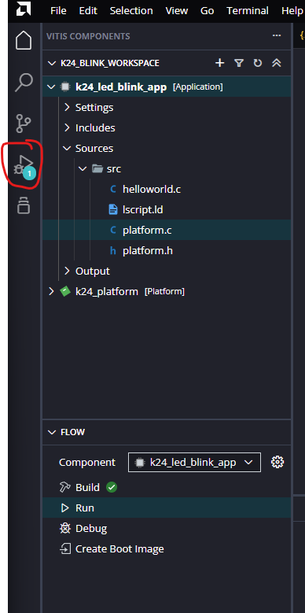

*Figure 21: Starting the application debugging session in Vitis.*

The debugger establishes communication with the target processor and downloads the application.

### 11.2 Continue Application Execution

During the debugging process, the application may stop at a breakpoint or wait for execution to continue.

Click the **Continue** button to allow the application to execute.

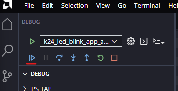

*Figure 22: Continuing application execution from the Vitis debugger.*

### 11.3 Verify UART Output

Observe the output in the CoolTerm serial terminal.

The expected output is:

```text
Hello World
Successfully ran Hello World application
```

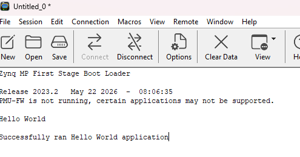

*Figure 23: Expected Hello World output through the UART interface.*

Successful output confirms that the application is executing and that UART communication is working.

## 12. Expected Outcome

At the end of this stage, you should have:

- A Vitis workspace configured for the K24 development board.
- An imported XSA hardware specification.
- A software platform named `k24_platform`.
- A standalone domain targeting `psu_cortexa53_0`.
- A generated Board Support Package.
- Access to the PS GPIO driver.
- A bare-metal application.
- A successfully built Hello World application.
- Working UART communication through CoolTerm.

The generated software platform is now ready for GPIO application development.

## 13. Summary

In this stage, the hardware specification exported from Vivado was imported into Vitis to create a software platform for the ARM Cortex-A53 processor.

The platform was configured with the Standalone operating system, and the necessary software drivers were selected.

A Hello World application was created, built, and executed to verify the software environment and UART communication.

With the software platform established, the next stage involves implementing the actual GPIO functionality to control the onboard D13 LED through MIO27.

**Next:** [Part 3 – Bare-Metal MIO GPIO Programming](part3-mio-gpio-programming.md)
