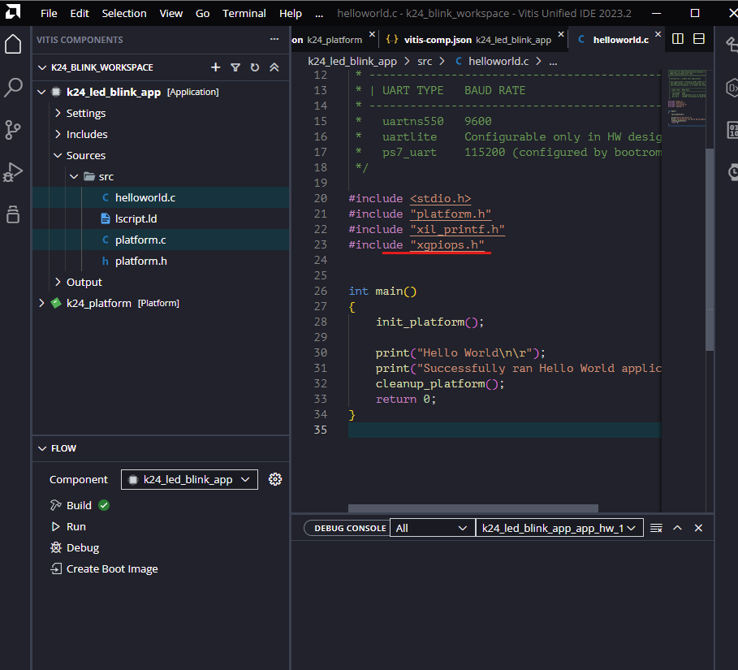
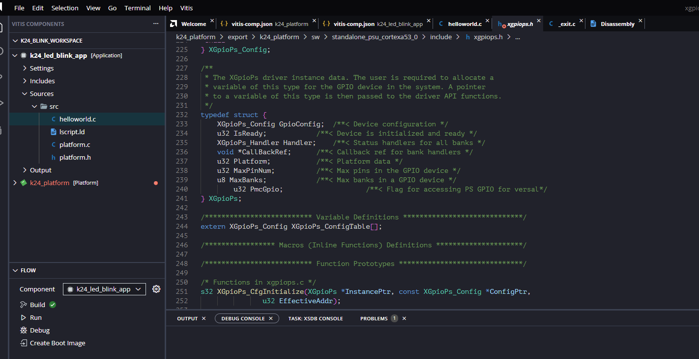
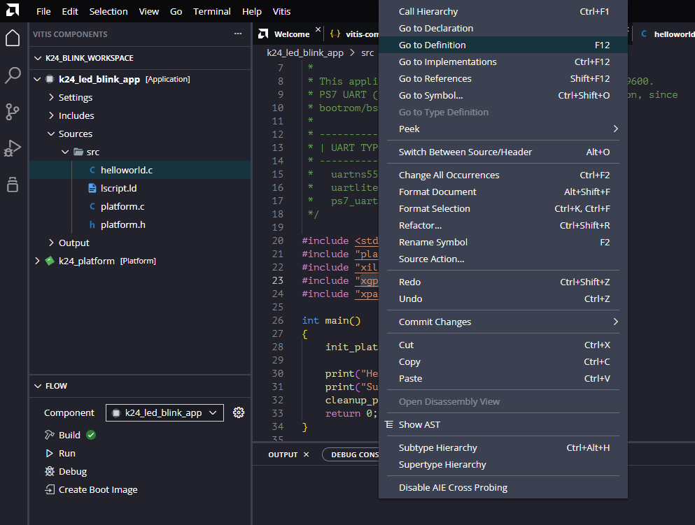
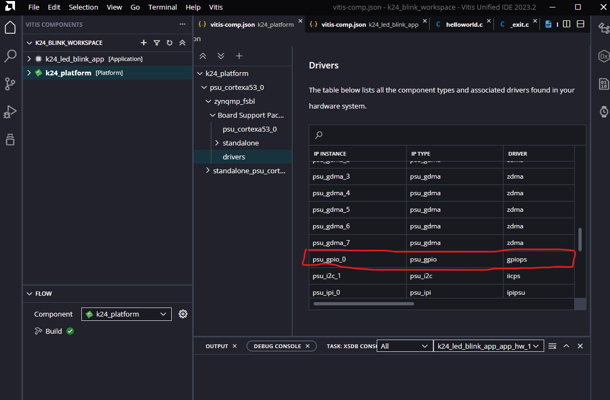
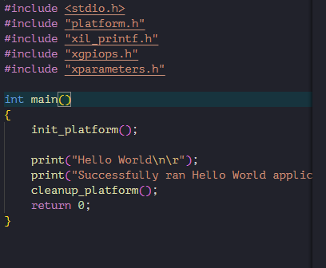
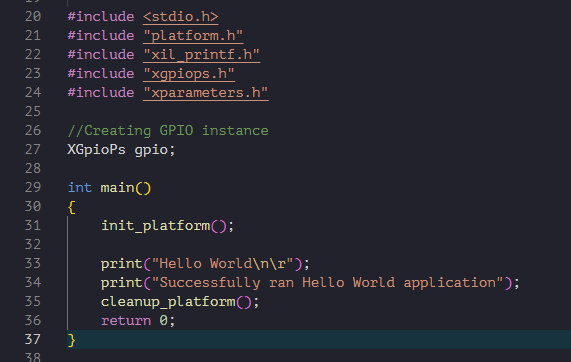
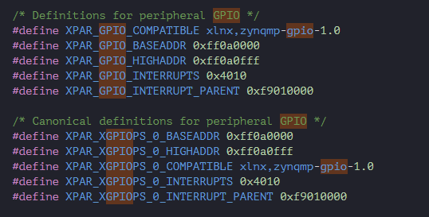
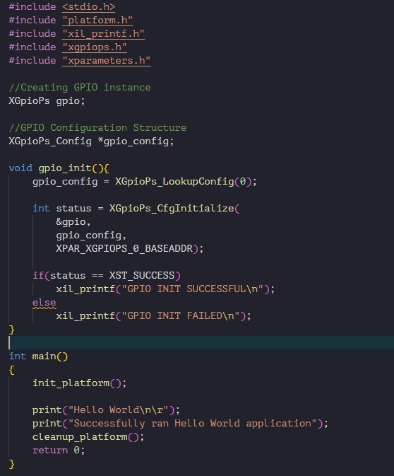
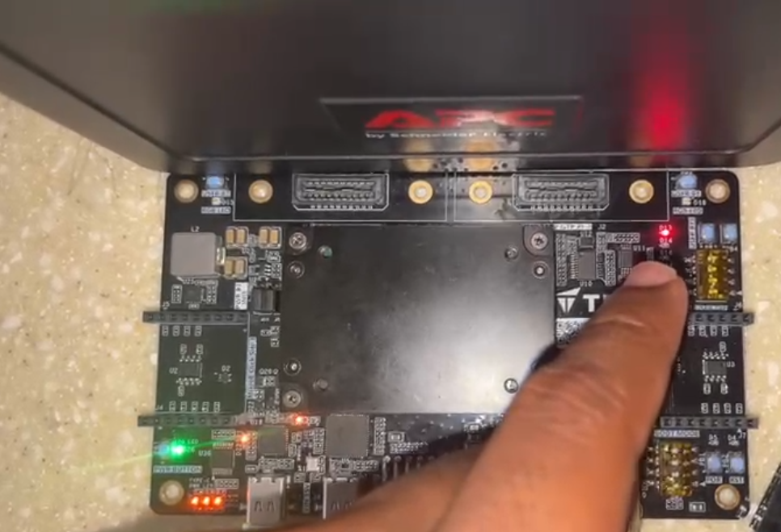

# Part 3: Bare-Metal MIO GPIO Programming – Avnet K24 PS MIO LED Blink

## 1. Introduction

In the previous stages, the Zynq UltraScale+ MPSoC hardware was configured in Vivado, and a standalone software platform was generated in Vitis.

This final stage focuses on implementing the bare-metal C application responsible for controlling the onboard D13 LED through the Processing System (PS) GPIO peripheral.

The target LED is connected to MIO27. The application uses the Xilinx `XGpioPs` driver to initialize the PS GPIO controller, configure MIO27 as an output, enable the output driver, and periodically change the GPIO output state.

The application executes directly on the ARM Cortex-A53 processor using the Standalone software environment.

### Objectives

By the end of this section, you should understand how to:

- Understand the organization of the Xilinx PS GPIO driver.
- Locate the GPIO driver within the generated Board Support Package (BSP).
- Retrieve the GPIO peripheral configuration.
- Initialize the PS GPIO controller.
- Configure MIO27 as an output.
- Enable the GPIO output driver.
- Write logic values to a GPIO pin.
- Introduce delays using the Standalone software environment.
- Build and execute a bare-metal GPIO application.

## 2. Understanding the PS GPIO Driver

The Zynq UltraScale+ MPSoC provides an integrated GPIO controller within the Processing System.

The Xilinx `XGpioPs` driver provides a software interface for interacting with this controller.

Instead of directly accessing GPIO registers, the application uses the driver API to configure and control the GPIO peripheral.

The primary GPIO driver is `XGpioPs`.



*Figure 1: Xilinx PS GPIO driver.*

### 2.1 GPIO Driver Header File

The primary driver header file is:

`xgpiops.h`

It provides the declarations required to use the PS GPIO driver API, including the GPIO data structures and function prototypes.

The header is included in the application using:

```c
#include "xgpiops.h"
```



*Figure 2: Xilinx PS GPIO driver header file.*

### 2.2 GPIO Driver Definitions

The GPIO driver definitions provide the structures, types, and function declarations used by the application.

These definitions allow the software to interact with the GPIO controller through the Xilinx driver API.



*Figure 3: GPIO driver definitions.*

## 3. Understanding the Board Support Package

The Board Support Package (BSP) is generated during the Vitis platform build process.

It provides the software drivers and hardware configuration definitions required by applications running on the selected processor.

For this project, the important driver is the PS GPIO driver.

### 3.1 GPIO Driver in the BSP

The GPIO driver is integrated into the generated software platform and provides access to the PS GPIO controller.



*Figure 4: GPIO driver files within the generated BSP.*

The application uses the GPIO driver through the `XGpioPs` API.

Some of the important functions provided by the driver include:

| Function | Purpose |
|---|---|
| `XGpioPs_LookupConfig()` | Retrieves the GPIO peripheral configuration. |
| `XGpioPs_CfgInitialize()` | Initializes the GPIO driver instance. |
| `XGpioPs_SetDirectionPin()` | Configures a GPIO pin as an input or output. |
| `XGpioPs_SetOutputEnablePin()` | Enables or disables the GPIO output driver. |
| `XGpioPs_WritePin()` | Writes a logic value to a GPIO pin. |

### 3.2 Hardware Parameters

The `xparameters.h` file contains hardware configuration definitions generated for the software platform.

These definitions provide information about the peripherals available in the hardware design, including their addresses and configuration parameters.

For this project, the GPIO controller base address is accessed using:

```c
XPAR_XGPIOPS_0_BASEADDR
```

The application uses this definition when initializing the GPIO driver.



*Figure 5: Generated hardware parameters in xparameters.h.*

## 4. GPIO Initialization

Before controlling the onboard LED, the application must initialize the GPIO peripheral and configure the target pin.

The initialization process involves:

1. Declaring the GPIO driver instance.
2. Retrieving the GPIO configuration.
3. Initializing the GPIO driver.
4. Checking the initialization status.

### 4.1 Declare the GPIO Instance

The GPIO driver instance is declared using:

```c
XGpioPs gpio;
```

The configuration structure is declared as:

```c
XGpioPs_Config *gpio_config;
```

The `XGpioPs` structure represents the GPIO driver instance, while `XGpioPs_Config` contains the configuration information required to initialize the peripheral.



*Figure 6: GPIO configuration structure.*

### 4.2 Retrieve the GPIO Configuration

The GPIO configuration is retrieved using:

```c
gpio_config = XGpioPs_LookupConfig(0);
```

The `XGpioPs_LookupConfig()` function retrieves the configuration associated with the GPIO controller.

For the generated BSP used in this project, `0` is used to retrieve the configuration for the single GPIO controller.

The returned configuration pointer is passed to the initialization function.



*Figure 7: Retrieving the GPIO controller configuration using XGpioPs_LookupConfig().*

### 4.3 Initialize the GPIO Driver

After retrieving the configuration, initialize the GPIO driver using:

```c
int status;

status = XGpioPs_CfgInitialize(
    &gpio,
    gpio_config,
    XPAR_XGPIOPS_0_BASEADDR
);
```

The function receives three arguments:

| Argument | Description |
|---|---|
| `&gpio` | Pointer to the GPIO driver instance. |
| `gpio_config` | Pointer to the GPIO configuration structure. |
| `XPAR_XGPIOPS_0_BASEADDR` | Base address of the PS GPIO controller. |

The function initializes the driver instance using the supplied configuration and base address.

The returned status is checked to determine whether initialization was successful.

```c
if (status == XST_SUCCESS) {
    xil_printf("GPIO initialization successful\r\n");
}
else {
    xil_printf("GPIO initialization failed\r\n");
}
```

Checking the initialization status prevents the application from continuing when the GPIO driver cannot be initialized.



*Figure 8: Initializing the PS GPIO controller using XGpioPs_CfgInitialize().*

## 5. Configure MIO27 as an Output

After initializing the GPIO controller, MIO27 must be configured as an output.

Recall that the onboard D13 LED is connected to MIO27.

### 5.1 Set the GPIO Direction

The direction is configured using:

```c
XGpioPs_SetDirectionPin(&gpio, 27, 1);
```

The function takes three arguments:

| Argument | Description |
|---|---|
| `&gpio` | GPIO driver instance. |
| `27` | Target MIO pin number. |
| `1` | Configures the pin as an output. |

For GPIO direction configuration:

- `0` represents an input.
- `1` represents an output.

Therefore, MIO27 is configured as an output.

### 5.2 Enable the Output Driver

After configuring the direction, enable the output driver:

```c
XGpioPs_SetOutputEnablePin(&gpio, 27, 1);
```

This enables the GPIO output driver for MIO27.

Both the direction and output-enable configurations are required for the intended GPIO output operation.

## 6. Control the Onboard LED

Once MIO27 has been configured as an output, the application can control the LED by writing logic values to the GPIO pin.

### 6.1 Write Logic HIGH

To drive MIO27 HIGH:

```c
XGpioPs_WritePin(&gpio, 27, 1);
```

This writes a logic HIGH value to the GPIO output.

### 6.2 Write Logic LOW

To drive MIO27 LOW:

```c
XGpioPs_WritePin(&gpio, 27, 0);
```

This writes a logic LOW value to the GPIO output.

### 6.3 Introduce a Delay

The application uses the `sleep()` function to introduce a delay between output transitions.

The required header is:

```c
#include "sleep.h"
```

For example:

```c
XGpioPs_WritePin(&gpio, 27, 1);
sleep(1);

XGpioPs_WritePin(&gpio, 27, 0);
sleep(1);
```

The one-second delay allows the output state to remain unchanged long enough to make the blinking visible.

**Note:** The relationship between GPIO HIGH/LOW and LED ON/OFF depends on the electrical polarity of the board's LED circuit.

## 7. Complete Source Code

The following is the complete bare-metal application used in this project.

### `main.c`

```c
#include "platform.h"
#include "xil_printf.h"
#include "xgpiops.h"
#include "xparameters.h"
#include "xstatus.h"
#include "sleep.h"

/* GPIO instance */
XGpioPs gpio;

/* GPIO configuration structure */
XGpioPs_Config *gpio_config;

/*
 * Initialize the Processing System GPIO controller.
 */
int gpio_init(void)
{
    /* Retrieve GPIO configuration */
    gpio_config = XGpioPs_LookupConfig(0);

    if (gpio_config == NULL) {
        xil_printf("ERROR: GPIO configuration not found\r\n");
        return XST_FAILURE;
    }

    /* Initialize GPIO driver */
    int status = XGpioPs_CfgInitialize(
        &gpio,
        gpio_config,
        XPAR_XGPIOPS_0_BASEADDR
    );

    if (status != XST_SUCCESS) {
        xil_printf("ERROR: GPIO initialization failed\r\n");
        return XST_FAILURE;
    }

    xil_printf("GPIO initialization successful\r\n");

    return XST_SUCCESS;
}

int main(void)
{
    /* Initialize platform */
    init_platform();

    /* Initialize PS GPIO */
    if (gpio_init() != XST_SUCCESS) {
        cleanup_platform();
        return XST_FAILURE;
    }

    /* Configure MIO27 as an output */
    XGpioPs_SetDirectionPin(&gpio, 27, 1);

    /* Enable MIO27 output driver */
    XGpioPs_SetOutputEnablePin(&gpio, 27, 1);

    xil_printf("Starting MIO27 LED blink application\r\n");

    /* Continuously toggle the onboard D13 LED */
    while (1) {

        /* Set GPIO output HIGH */
        XGpioPs_WritePin(&gpio, 27, 1);
        sleep(1);

        /* Set GPIO output LOW */
        XGpioPs_WritePin(&gpio, 27, 0);
        sleep(1);
    }

    return 0;
}
```

## 8. Build and Execute the Application

After completing the GPIO initialization and pin configuration, build the application in Vitis and execute it on the K24 development board.

### 8.1 Build the Application

1. Save the `main.c` file.
2. Select the application component in Vitis.
3. Build the application.
4. Check the build output for compilation errors.
5. Confirm that the build completes successfully.



*Figure 9: Building the bare-metal LED blink application in Vitis.*

### 8.2 Execute the Application

After a successful build:

1. Connect the K24 development board to the host computer.
2. Configure the target connection in Vitis.
3. Launch the application using the run or debug configuration.
4. Allow the application to execute on the Cortex-A53 processor.
5. Observe the D13 LED on the development board.

The application initializes the GPIO controller, configures MIO27, and continuously toggles its output state.

## 9. Hardware Demonstration

The following image shows the onboard LED during execution of the application.


*Figure 10: Onboard D13 LED controlled through PS MIO27.*

The LED blinking demonstrates successful interaction between the ARM Cortex-A53 processor and the onboard LED through the PS GPIO peripheral.

## 10. Troubleshooting

### GPIO Initialization Failure

If the application reports that GPIO initialization failed:

- Confirm that the XSA file was generated from the correct Vivado project.
- Verify that the GPIO peripheral is available in the imported hardware platform.
- Check that the GPIO base address corresponds to the generated BSP.
- Confirm that the configuration lookup returns a valid pointer.

### LED Does Not Illuminate

If the LED does not respond:

- Confirm that the correct GPIO MIO bank is enabled in Vivado.
- Verify that the target LED is connected to MIO27.
- Confirm that MIO27 is configured as an output.
- Verify that the GPIO output driver is enabled.
- Check the LED's electrical polarity.

### Application Does Not Execute

If the application fails to execute:

- Confirm that the platform and application build successfully.
- Verify that the correct processor target is selected.
- Check the Vitis target connection.
- Ensure that the application is being executed on the Cortex-A53 standalone domain.

## 11. Expected Outcome

After successfully implementing and running the application:

- The PS GPIO controller initializes successfully.
- MIO27 is configured as an output.
- The GPIO output driver is enabled.
- The application continuously toggles the output state.
- The onboard D13 LED blinks.

The application executes entirely on the ARM Cortex-A53 processor without requiring custom PL logic.

## 12. Key Learning Outcomes

This implementation provides practical experience with:

- Bare-metal programming on the Zynq UltraScale+ MPSoC.
- Xilinx PS GPIO driver integration.
- GPIO controller initialization.
- BSP and hardware configuration integration.
- MIO pin configuration.
- GPIO direction and output-enable control.
- Software-controlled GPIO output.
- Hardware and software integration using Vivado and Vitis.

## 13. Conclusion

This project demonstrates how to control a physical onboard LED directly through the Processing System GPIO controller of the Avnet K24 Development Kit.

By configuring MIO27 and using the Xilinx `XGpioPs` driver, a bare-metal C application running on the ARM Cortex-A53 processor can control the D13 LED without implementing additional GPIO logic in the Programmable Logic.

The implementation provides a foundation for more advanced PS peripheral applications, including multiple GPIO outputs, button inputs, interrupt-driven GPIO, and communication between the Processing System and Programmable Logic.

---

**Previous:** [Part 2 – Vitis Software Platform Setup](part2-vitis-setup.md)

**Back to:** [Project README](../README.md)
